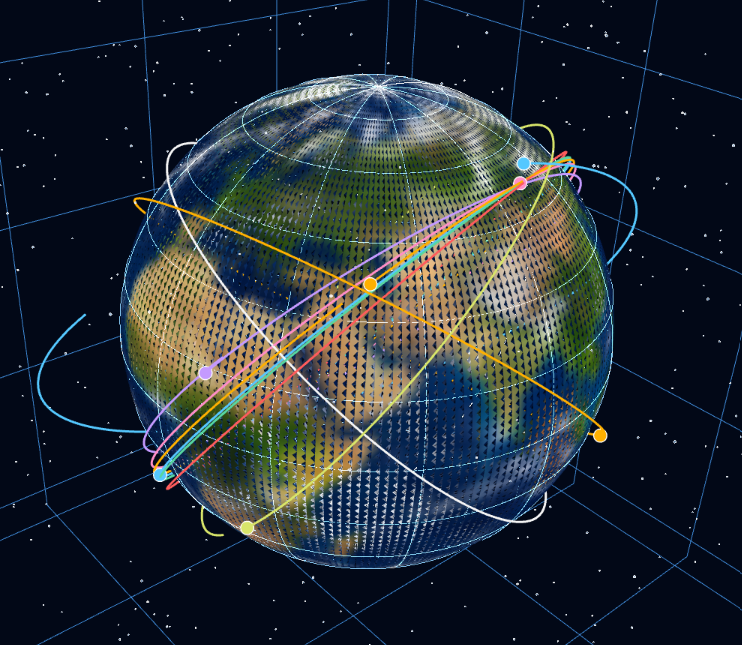
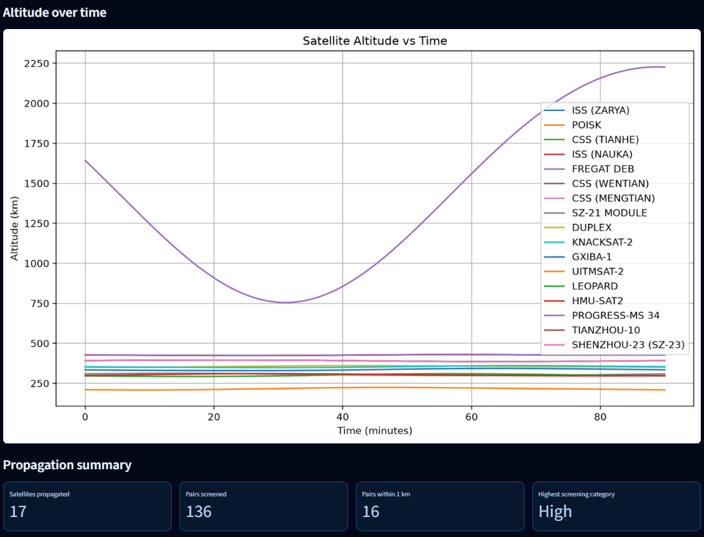

# Satellite Trajectory Dashboard

A Python-based satellite orbit propagation and interactive visualization system.

The **Satellite Trajectory Dashboard** is an orbital-analysis project that uses Two-Line Element (TLE) data and the SGP4 propagation model to estimate satellite trajectories. It combines orbital computation, pairwise separation analysis, and an interactive 3D dashboard to make satellite motion easier to explore.

The application is built with Python and Streamlit, with Plotly for interactive 3D visualization and Matplotlib for altitude analysis.

**Repository:** [SakethaRamK/satellite-trajectory-dashboard](https://github.com/SakethaRamK/satellite-trajectory-dashboard)

## Dashboard Preview



## Overview

Satellite motion can be studied by propagating orbital elements over time and examining the resulting positions and velocities. When multiple satellites are considered, their relative motion can also be analyzed to estimate their minimum separation during a prediction window.

This project brings these tasks together in a single dashboard. It acquires and validates TLE records, generates trajectories, evaluates pairwise separation, and presents the resulting information through interactive visualizations and summary metrics.

The project also contains separate implementations of Euler and fourth-order Runge–Kutta (RK4) numerical propagation, supporting further exploration of numerical integration and orbital dynamics.

## Features

### 1. TLE data acquisition and validation

- Retrieves general-perturbations orbital data from CelesTrak's STATIONS group when network access is available.
- Parses named TLE records and validates their orbital-data lines.
- Maintains a local TLE cache for reuse when a download fails.
- Records data-source and download-status metadata, including the last attempt and last successful download in UTC.
- Checks TLE epoch age during satellite initialization and rejects records outside the implementation's accepted time range.

A fresh installation may need internet access to obtain its initial TLE dataset because the runtime cache is not included in the repository.

### 2. SGP4 orbit propagation

- Propagates satellite states from TLE data using the SGP4 model.
- Generates position, velocity, altitude, and speed information along each trajectory.
- Uses a prediction window of approximately 90 minutes, sampled at 10-second intervals in the current implementation.
- Handles trajectory-generation failures by skipping unavailable trajectories rather than including them in the successful results.

SGP4 is the primary propagation method used by the dashboard.

### 3. Interactive 3D Earth and orbit visualization

- Renders satellite trajectories around a three-dimensional Earth.
- Displays multiple satellite orbits with distinct colors.
- Uses Plotly for interactive inspection of the orbit visualization.
- Includes a starfield, Earth surface rendering, coordinate grids, and satellite position markers.
- Provides a consistent 3D scene with labeled axes in kilometres.

The visualization helps users explore the spatial geometry of satellite motion.

### 4. Altitude analysis

- Plots satellite altitude against elapsed time.
- Displays multiple satellite trajectories on the same altitude chart.
- Uses kilometres for altitude and minutes for elapsed time.
- Helps reveal altitude variation over the selected propagation window.

### 5. Pairwise relative-motion analysis

- Compares propagated trajectories for satellite pairs.
- Calculates relative position, separation distance, and relative speed at corresponding sample times.
- Identifies a coarse minimum-separation time and refines the search around that interval.
- Calculates summary information about pairwise separation during the prediction window.

The project retains the underlying relative-motion calculations, which can support further analysis and future extensions.

### 6. Streamlit dashboard

The interface provides:

- A dark, space-themed layout.
- A manual **Refresh satellite data** action.
- TLE cache and data-source status.
- Last download and attempt timestamps in UTC.
- Interactive 3D orbit visualization.
- Altitude-over-time plots.
- Satellite-specific altitude, speed, and latest state-time metrics.
- Propagation summary metrics, including the number of satellites propagated, pairs screened, pairs within the 1 km threshold, and the highest screening category.

The dashboard retains calculated results in Streamlit session state so they remain available during subsequent interface interactions within that session.

### 7. Numerical propagation and orbital utilities

Separate modules implement additional orbital and mathematical functionality:

- Euler numerical propagation.
- Fourth-order Runge–Kutta (RK4) numerical propagation.
- Coordinate-frame calculation utilities.
- Orbital calculations and vector operations.
- TLE parsing and validation.

These modules provide a foundation for extending the project with propagation comparisons, additional validation, and more detailed orbital-analysis workflows.

## Technology Stack

| Technology | Role |
|---|---|
| Python | Core implementation and orbital calculations |
| Streamlit | Interactive web dashboard |
| SGP4 | Satellite state propagation from TLE data |
| NumPy | Numerical arrays and mathematical operations |
| Plotly | Interactive 3D orbit visualization |
| Matplotlib | Altitude plots and additional plotting utilities |
| Requests | Retrieval of remote TLE data |
| Pillow | Earth texture image handling |

## Architecture

The project follows a modular design, separating the dashboard interface, orbital propagation, visualization, and supporting mathematical calculations into dedicated Python modules.

- **Dashboard layer (`dashboard.py`):** Provides the Streamlit interface, displays satellite information and analysis results, and manages visualizations and summary metrics.
- **Propagation and analysis layer (`sgp4_propagation.py`):** Handles TLE data acquisition and caching, SGP4 trajectory generation, satellite state calculations, pairwise separation analysis, and associated summary calculations.
- **Visualization layer (`satellite_visualization.py`):** Creates the interactive three-dimensional Earth and satellite-orbit visualization using Plotly.
- **Orbital calculations (`satellite_orbit.py`):** Contains orbital calculation utilities used by the numerical propagation implementations.
- **Coordinate transformations (`coordinate_frames.py`):** Provides coordinate-frame calculation utilities for satellite state analysis.
- **TLE processing (`tle_parser.py`):** Supports TLE parsing and validation.
- **Mathematical utilities (`vector_operations.py`):** Provides vector arithmetic and magnitude calculations.
- **Numerical propagation (`euler_propagation.py`, `rk4_propagation.py`):** Implements Euler and fourth-order Runge–Kutta methods for exploring numerical integration.

This separation makes the code easier to maintain, test, and extend. The dashboard consumes propagation results, while supporting modules organize orbital calculations and visualization responsibilities.

## Project Structure

```text
satellite-trajectory-dashboard/
│
├── dashboard.py
├── sgp4_propagation.py
├── satellite_visualization.py
├── satellite_orbit.py
├── coordinate_frames.py
├── tle_parser.py
├── vector_operations.py
├── euler_propagation.py
├── rk4_propagation.py
│
├── earth_texture.jpg
├── requirements.txt
├── .gitignore
└── README.md
```

| File | Responsibility |
|---|---|
| `dashboard.py` | Streamlit interface, data status, plots, and propagation metrics |
| `sgp4_propagation.py` | TLE acquisition and caching, SGP4 propagation, and relative-motion calculations |
| `satellite_visualization.py` | Earth rendering and interactive Plotly orbit visualization |
| `satellite_orbit.py` | Orbital calculations used by the numerical propagation modules |
| `coordinate_frames.py` | Coordinate-frame calculation utilities |
| `tle_parser.py` | TLE validation and parsing support |
| `vector_operations.py` | Vector arithmetic and magnitude calculations |
| `euler_propagation.py` | Euler numerical integration implementation |
| `rk4_propagation.py` | Fourth-order Runge–Kutta numerical integration implementation |
| `earth_texture.jpg` | Earth imagery asset used by the visualization |
| `requirements.txt` | Python package dependencies |
| `.gitignore` | Excludes generated files and local-only data |

## Installation and Setup

### Prerequisites

- Python 3.10 or later recommended.
- Git.
- Internet access for initial TLE acquisition.
- A modern web browser.

The project should be tested against the selected Python version before declaring it officially supported.

### 1. Clone the repository

```bash
git clone https://github.com/SakethaRamK/satellite-trajectory-dashboard.git
cd satellite-trajectory-dashboard
```

### 2. Create a virtual environment

**Windows PowerShell**

```powershell
python -m venv .venv
.\.venv\Scripts\Activate.ps1
```

If PowerShell prevents environment activation, use a Command Prompt terminal and run:

```bat
.venv\Scripts\activate.bat
```

### 3. Install dependencies

```bash
python -m pip install --upgrade pip
python -m pip install -r requirements.txt
```

### 4. Launch the dashboard

```bash
python -m streamlit run dashboard.py
```

Open the local URL displayed by Streamlit in your browser.

### 5. Generate and explore the analysis

1. Open the dashboard.
2. Select **Refresh satellite data**.
3. Allow the application to retrieve or load available TLE data and generate trajectories.
4. Explore the 3D orbit visualization and altitude plots.
5. Review satellite state metrics and propagation summary metrics.

If TLE acquisition fails and no usable local cache exists, the application cannot generate the trajectory results.

## Technical Approach

### TLE-based propagation

The application uses TLE records as inputs to the SGP4 propagator. Propagated position and velocity states are used to build trajectories and derive quantities such as altitude, speed, and pairwise separation.

TLEs are epoch-dependent orbital data. Their age and quality influence the usefulness of propagated states, so the data source and timestamp should be considered when interpreting results.

### Relative motion and minimum separation

For each satellite pair, the implementation evaluates relative positions over the sampled propagation interval. The separation at a sample is the magnitude of the difference between the two position vectors.

The minimum sampled separation identifies a candidate interval of closest approach. The implementation then evaluates a refined interval around that candidate to estimate the minimum distance and associated time.

The refinement improves temporal resolution near the sampled minimum; it does not by itself guarantee a globally exact closest-approach solution.

### Numerical integration

Euler and RK4 are implemented in separate modules for exploring numerical integration of orbital motion. Their accuracy depends on the equations of motion, force model, initial state, and integration step.

The dashboard's main trajectory results use SGP4; the presence of Euler and RK4 modules does not mean their outputs have already been benchmarked against SGP4.

## Data Handling and Limitations

- **Network dependency:** Initial TLE acquisition requires a reachable data source.
- **Local cache:** The TLE cache and its metadata are generated at runtime and are excluded from version control. A new clone will not automatically contain a cache.
- **TLE age:** Propagation quality depends on the input TLE epoch and data quality.
- **Finite prediction window:** The current implementation evaluates an approximately 90-minute trajectory window.
- **Sampling and refinement:** A sampled search can miss events between samples; local refinement does not remove all numerical uncertainty.
- **Numerical propagation:** Euler and RK4 results depend on their implemented dynamics and integration parameters.
- **Operational use:** The project is intended for learning and exploratory analysis, not real-world collision-avoidance decisions.

## Development Roadmap

Potential next steps include:

- Unit tests for TLE parsing and vector operations.
- Validation tests for coordinate-frame calculations.
- Numerical checks for SGP4 and Euler/RK4 propagation.
- Automated tests for failed downloads, missing cache data, and malformed TLE records.
- Better logging and separation of computational logic from the user interface.
- Screenshot-based documentation of the dashboard.
- Continuous integration with GitHub Actions.
- Deployment of the Streamlit application.
- Further investigation of uncertainty-aware conjunction assessment.

These are proposed improvements, not claims that all of them are already implemented.

## Author

**Saketha Ram K**

GitHub: [@SakethaRamK](https://github.com/SakethaRamK)

## Disclaimer

This repository is an educational and exploratory software project. Its orbital estimates and pairwise separation analysis are not a substitute for authoritative orbital data, validated conjunction-assessment systems, or professional collision-avoidance analysis.
